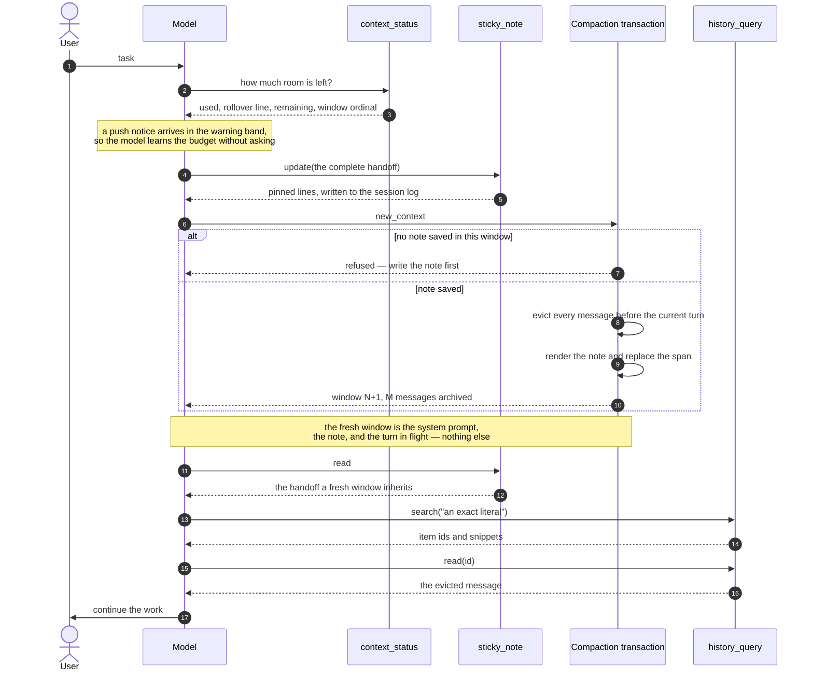
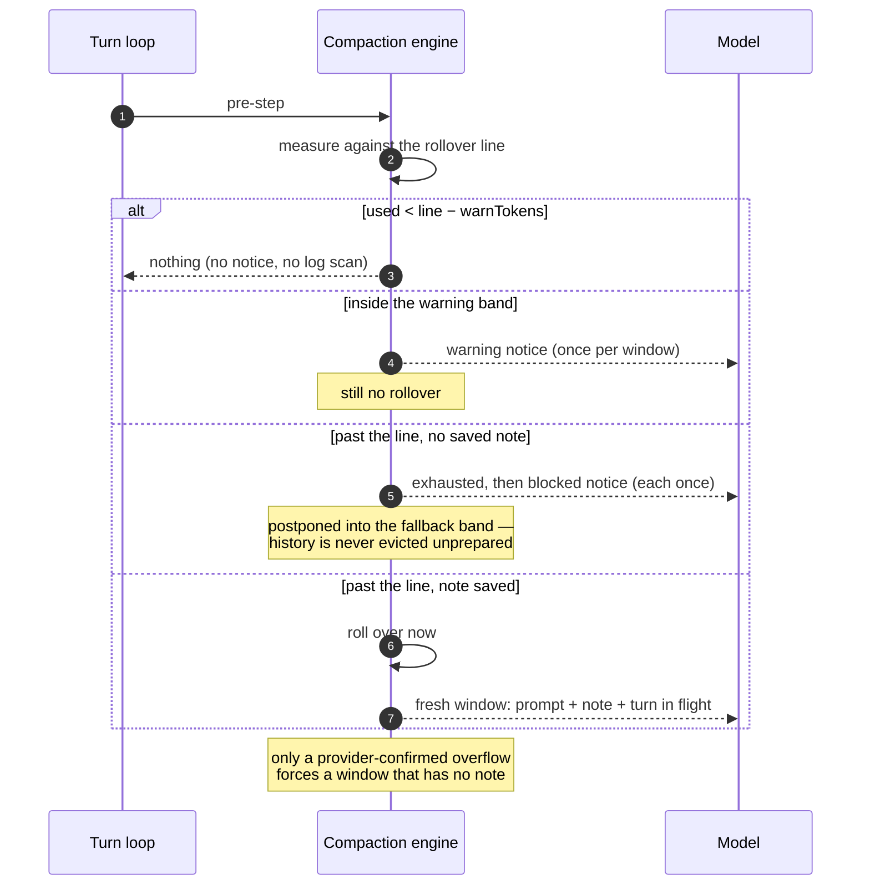

# dsh-compaction-sticky-window

English | [中文](README.zh.md)

A DeepSeek Harness profile bundle that replaces the summarizing context compactor with **a model-written handoff note and a fresh window that keeps almost nothing else**.

The shipped backend condenses an old span into a model-written summary: one extra model call per rollover, and a summary whose contents the model did not choose. This backend inverts the ownership. The model writes its own note with `sticky_note`, opens a new window with `new_context`, and that window starts with the system prompt, the note, and the work in flight — nothing else. One deterministic fallback remains for automatic pressure: if no note was written, the evicted messages are reduced to the facts the log can prove.

## Install

From a checkout of this repository:

```sh
dsh plugin --profile <profile> add /absolute/path/to/dsh-compaction-sticky-window
```

Or through the Plugins page, which installs the bundle and enables it. The bundle patch retires the summarizing backend on every plane the profile exposes, so nothing else needs composing.

## What installing adds, and what it never replaces

Installing adds. It adds one compaction backend on the host plane, one optional agent preset, and four tools. It does not take a tool away, and it does not change which preset your sessions use.

| Profile kind | Compaction owner | What the bundle does |
|---|---|---|
| CLI, headless, SDK | A host-plane row from the base bundle | Disables `compaction-basic` and inserts this backend in its place; the four tools are added |
| Web, Desktop | Each agent preset, inside a group that isolates `compaction` | Ships one more preset, identical to the shipped `standard` except for its compaction group; you select it if you want it |

On a preset-backed profile a host-plane row cannot reach a session: the preset isolates `compaction`, so its own backend serves its own agents. That is why the bundle ships `presets/sticky-window.patch.yml` — the shipped `standard` preset with one group changed.

**This bundle never touches `agent-preset-registry`.** Switching the selected preset under a running session tears down the tools of the preset in use and leaves that session without them until a new one starts; forcing a default would do exactly that to every open session. The choice stays yours: **Settings → Agent preset → Sticky window**. Until then the shipped preset keeps running the shipped backend, and every existing tool stays where it is.

The bundled preset's child list is the shipped `standard` list with the compaction group swapped, and `npm run sync-preset` refuses to write a snapshot whose plugin ids differ from the installation it read. Re-run it after a DSH upgrade.

## The window lifecycle

```
work proceeds ──► context_status: tokens left?
                        │
        ┌───────────────┴────────────────┐
        │ room enough                    │ note is current, room tight
        ▼                                ▼
   keep working                 sticky_note update  ──►  new_context
                                        │                   │
                                        │           no note saved → refused
                                        │                   │
                                        ▼                   ▼
                              note saved          window ends: every message
                                                  before the current turn is
                                                  evicted, becomes archive
                                                            │
                                                            ▼
                              fresh window = system prompt + note + turn in flight
                                                            │
                                            detail missing? → history_query
```

### Sequence: the model opens a window



### Sequence: automatic pressure



Automatic pressure is a three-stage ramp, not a cliff:

| Stage | At | What happens |
|---|---|---|
| warning | `threshold − warnTokens` | A notice asks for the note while there is still room to write it. |
| exhausted | `threshold` | A second notice says the window's budget is spent and the next action is `sticky_note` then `new_context`. A rollover happens here **only if a note is saved**. |
| blocked | `ceiling = min(threshold + fallbackTokens, capacity)` | With no saved note the window still does not end; the notice now says writing the note is the only action that matters. |

Each notice fires at most once per window. The rollover itself is postponed — never forced — while the note is missing, because evicting history the model never wrote down is the failure this backend exists to prevent. The single exception is a provider-confirmed context overflow, where the window must end: the note then says plainly that none was written and carries only the recorded facts.

Because the retained window is empty by default (`retainTokens: 0`), the fresh window is genuinely fresh. Set `retainTokens` or `retainRatio` to keep a verbatim tail instead.

## The note

Two sections, and only the first is the model's:

| Section | Source |
|---|---|
| `## Handoff` | The model's `sticky_note` list, carried verbatim. Claims its byte budget first. |
| `## Recorded facts` | Derived from the evicted messages: file paths and commands recovered from tool-call arguments, and tool results that reported an error. Suppressed by `derivedAppendix: false`. |

The note is a normal checkpoint message on the surface, so the next rollover reads it back like any other evicted content — no side storage, and a replayed session rebuilds the identical note.

Pins are only read from a `sticky_note` result, so a file the agent read cannot inject or erase them. A pin list over budget is refused with an instruction to consolidate, not silently trimmed.

## The tools

| Tool | Answers |
|---|---|
| `context_status` | Tokens used, the rollover line, tokens remaining, the current window ordinal, and whether the figure is provider usage or a local estimate. |
| `sticky_note` | `read` returns the handoff a fresh window inherits; `update` replaces it. |
| `new_context` | Ends the window now. Refused while this window has no saved note. |
| `history_query` | `windows` lists archived windows, `search` finds a case-sensitive literal and returns item ids, `read` returns one item by id. |

All four are registered on the host plane; a preset realm inherits them through the `tools` registry it does not isolate.

`context_status` prices the same threshold the transaction triggers on, and reports the trigger's own refusals (`available: false` with the reason) rather than a plausible number that would never fire. `src/budget.js` mirrors that arithmetic and is tested against it.

`new_context` performs the rollover inside the tool call, bounded strictly before the current turn, so the turn's own tool results still have a surface to land on. The write-ahead gate is the reference behavior: no note, no new window.

`history_query` reads the archive the log already holds: each `compaction/summary` event records the seqs it replaced, and those events keep their seqs forever. Windows and items are named `w<window>:<ordinal>`.

## The prompt protocol

The bundle registers one `systemPrompt` section (order 9000) that states what a window is, that everything not written into the note disappears from the live context, when to check the budget, what a handoff must contain, that `new_context` needs a saved note, and how to recover a detail afterwards. It is registered with `interpolate: false` so its braces stay literal.

The reference implementations make the same move — Axon keeps a `<memory_window_protocol>` block in its stable prefix.

## Configuration

Every key is optional. Unknown keys fail at load instead of being ignored.

| Key | Default | Meaning |
|---|---|---|
| `thresholdRatio` | `0.8` | Share of the message budget that triggers an automatic rollover. |
| `retainTokens` | `0` | Verbatim tail kept after a rollover. `0` keeps only the turn in flight. |
| `retainRatio` | — | Fractional form of `retainTokens`; mutually exclusive with it. |
| `headroomTokens` | shipped default | Reserve subtracted from the context window before pressure is measured. |
| `maxTokens` | shipped default | Generation cap used when pricing the request. |
| `compactionRetries` | shipped default | Retries when one rollover does not fall below the threshold. |
| `maxOverflowRetries` | shipped default | Retries after a provider-confirmed context overflow. |
| `modelPolicies` | `[]` | Per-provider/model overrides of the fields above. |
| `auto` | `true` | Whether automatic pressure and overflow listeners are registered. |
| `noteMaxBytes` | `6144` | UTF-8 budget for the whole note. |
| `handoffMaxBytes` | `4096` | Budget for `## Handoff`; claimed before anything else. |
| `recordedMaxBytes` | `2048` | Budget for `## Recorded facts`. |
| `derivedAppendix` | `true` | Include the recorded-facts section. |
| `fileListMax` | `24` | Distinct file paths in the appendix. |
| `commandListMax` | `12` | Distinct commands in the appendix. |
| `pinnedLineMaxChars` | `400` | Per-line character cap for a pinned fact. |
| `warningTokens` | `6144` | Remaining budget at which `context_status` advises writing the note now. |
| `warnTokens` | `6144` | Distance before the rollover line at which the session pushes its first notice. |
| `fallbackTokens` | `16384` | Slack past the line during which a rollover waits for the note. |
| `minEvictTokens` | `1024` | Smallest span worth replacing; below it a rollover is refused, because the note's fixed framing would be larger than what it replaces. |
| `budgetRecheckMs` | `60000` | How long a failed or negative budget resolution is trusted before the model's capacity is asked again. |
| `notices` | `true` | Push budget notices into the model's context. |
| `historyReadMaxChars` | `4000` | Characters returned by one archive read. |
| `historySearchLimit` | `5` | Hits returned by one archive search. |
| `historySnippetChars` | `400` | Context characters shown around a hit. |
| `noteTool` | `true` | Register `sticky_note`. |
| `sensingTool` | `true` | Register `context_status`. |
| `historyTool` | `true` | Register `history_query`. |
| `newContextTool` | `true` | Register `new_context`. |
| `guidance` | `true` | Register the prompt protocol section. |

The note budget is additionally trimmed to half of the span it replaces, so a small span shrinks the note instead of failing the transaction's shrink check. A span too small to hold even the note's framing still fails loudly, exactly as the shipped backend does with a summary that cannot fit.

## Why this shape

- **The model owns the handoff.** A summary the model did not write is a guess about what matters. The reference implementations hand that decision to the model and give it a gate that makes writing it obligatory before a rollover it requests.
- **No side storage.** The note, the pins, and the archive index are ordinary surface content or existing log events, so fork, resume, and replay need no extra persistence and no format version.
- **No new session events.** The mechanism rides the existing `compaction/*` vocabulary.
- **No dependence on internal APIs.** The backend extends the published `BasicCompactionEngine` and overrides the documented `summarize()` hook; everything else is the shipped transaction.

## Development

```sh
node --test test/note.test.mjs test/engine.integration.mjs
node scripts/sync-preset.mjs
```

`test/engine.integration.mjs` drives real rollovers through the shipped compaction transaction with a hand-built Cordis Context, and asserts the fresh window really is the note plus the current turn.

`node_modules/.` holds a local junction to a DSH installation for module resolution in development and is not published.

## Known limitations

- The model can still under-write. When it does, the note carries only the recorded facts and says no handoff was written; it never fabricates one.
- If the model never writes a note, the window holds out until a provider-confirmed overflow forces it. That is deliberate — an unprepared rollover loses state — but it means a model that ignores every notice reaches the hard failure instead of a quiet one.
- The note's handoff is read from the whole session, so a note written in the turn that triggers a rollover is still carried.
- A single indivisible message larger than the window cannot be repaired by a rollover; the optional tool-result pruner still runs before selection.
- The bundled preset is a snapshot of `standard` at the targeted DSH release. A DSH upgrade can change that preset without this package noticing; run `sync-preset` and publish a new version.
- Choosing the bundled preset applies to **new** sessions. A session already running keeps the preset it started with — which is the reason this bundle never switches it for you, and also why a session that predates your choice keeps compacting the shipped way until you start another.
- On a preset-backed profile, installing this bundle changes nothing about compaction until you select its preset. The host-plane replacement cannot reach a session there, because the preset isolates `compaction`.
- Push notices are appended as ordinary `user/message` events with the `sticky-window-notice` source kind. The session format admits extension source kinds, so a log stays readable after the plugin is removed, but an older reader will not know that kind by name.
- On a DSH release whose base backend compacts on a **model switch** through a path that bypasses `compactIfNeeded`, that switch can still roll over without the note gate. The targeted 0.2.0 line has no such path; a later line would need this backend to gate it too.
