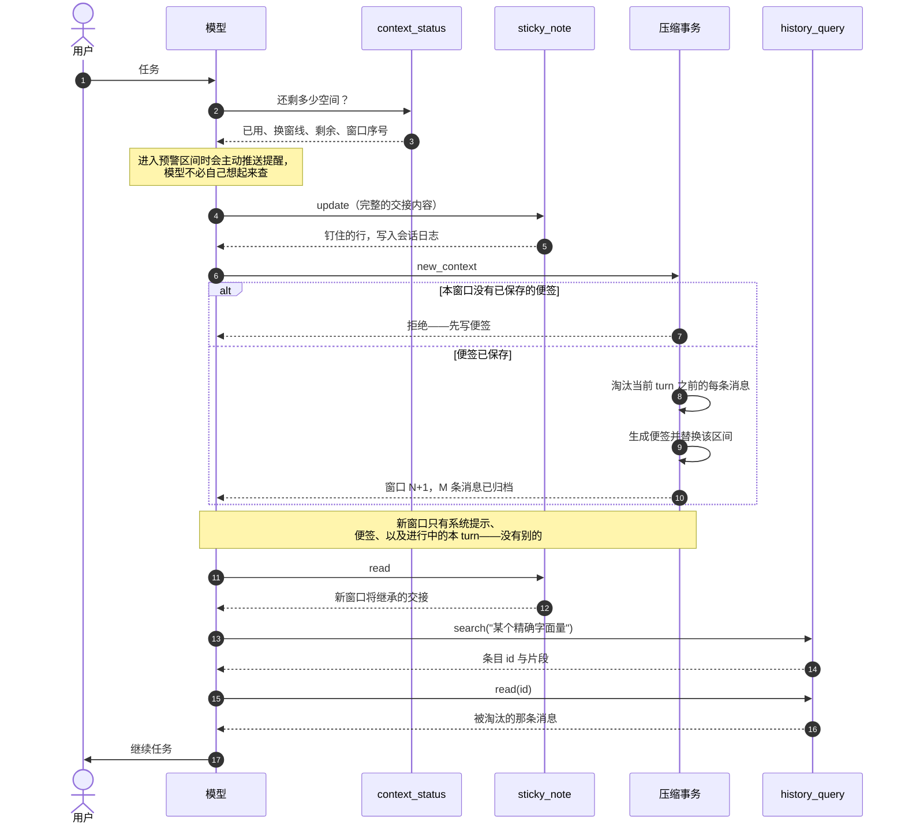
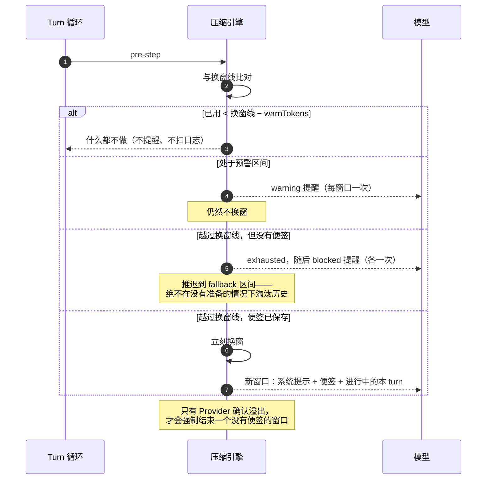

# dsh-compaction-sticky-window

一个 DeepSeek Harness profile bundle：用**模型自己写的交接便签 + 一个几乎什么都不留的新窗口**，取代摘要式上下文压缩。

自带后端把一段旧历史压成一段模型写的摘要：每次换窗多一次模型调用，而摘要里留什么并不是模型挑的。本后端把这件事的所有权翻过来。模型用 `sticky_note` 写自己的便签，用 `new_context` 开新窗口，新窗口只有系统提示、便签、以及正在进行中的本 turn——没有别的。只有自动压力触发时保留一条确定性兜底：如果没写过便签，被淘汰的消息会退化为日志能证明的客观事实。

## 安装

从本仓库的检出目录：

```sh
dsh plugin --profile <profile> add /absolute/path/to/dsh-compaction-sticky-window
```

也可以在插件页面安装并启用。bundle 补丁会在 profile 暴露的每一个平面上停用摘要后端，不需要再改其它组合。

## 安装新增什么，替换什么

安装**新增四个工具**、**替换压缩后端**。它不拿走任何工具，也不改变你的会话当前使用的 preset。

| Profile 类型 | 压缩归属 | bundle 的动作 |
|---|---|---|
| CLI、headless、SDK | base bundle 的 host 行 | 停用 `compaction-basic`，在原位置插入本后端；四个工具为新增 |
| Web、Desktop | 每个 agent preset 内、隔离 `compaction` 的组 | **原地覆盖** shipped `standard` preset——同一个 id、同一个 order——只把它的压缩组换掉 |

在有 preset 的 profile 上，host 行够不到会话：preset 隔离了 `compaction`，它自己的后端服务自己的 agent。官方支持的进入方式就是按该 preset 的 Loader 行 id 打覆盖，整份 `config` 被替换。`presets/sticky-window.patch.yml` 正是如此：重述 shipped `standard`，改掉其中一个组。因为 preset 的 id 与 order 不变，**没有任何东西需要选择**——bundle 装上，摘要后端就不在了。

本 bundle 仍然绝不触碰 `agent-preset-registry`。强行改默认 preset 会把每个打开中的会话切到另一个 preset，这和"在会话原本使用的 preset 内部替换后端"是两件事。

重述的子列表 = shipped `standard` 换掉压缩组，且 `npm run sync-preset` 在写快照前会校验插件 id 集合与它读取的安装完全一致。DSH 升级后请重新运行。

## 窗口生命周期

```
继续工作 ──► context_status：还剩多少 token？
                        │
        ┌───────────────┴────────────────┐
        │ 还有余量                       │ 便签已就绪、余量紧张
        ▼                                ▼
   继续工作                    sticky_note update  ──►  new_context
                                        │                   │
                                        │           没写过便签 → 拒绝
                                        │                   │
                                        ▼                   ▼
                                 便签已保存      窗口结束：当前 turn 之前的
                                                每条消息被淘汰，进入归档
                                                            │
                                                            ▼
                              新窗口 = 系统提示 + 便签 + 进行中的本 turn
                                                            │
                                            缺细节？ → history_query
```

### 时序：模型主动开新窗口



### 时序：自动压力触发



自动压力是三级坡度，不是悬崖：

| 阶段 | 触发点 | 发生什么 |
|---|---|---|
| warning | `threshold − warnTokens` | 推送提醒，请模型趁还有空间时写便签。 |
| exhausted | `threshold` | 第二次提醒：本窗口预算已用完，下一步是 `sticky_note` 然后 `new_context`。**只有便签已保存时**才在这里换窗。 |
| blocked | `ceiling = min(threshold + fallbackTokens, capacity)` | 没有便签时窗口依然不结束；提醒改为说明写便签才是唯一要紧的动作。 |

每个阶段的提醒在每个窗口最多推送一次。便签缺失期间，换窗只会被**推迟**、不会被强行执行，因为"淘汰掉模型从没写下来的历史"正是本后端要消除的失败。唯一的例外是 Provider 确认的上下文溢出：那里窗口必须结束，便签会明确写出"没有写过便签"，并且只带客观事实。

默认保留窗口为空（`retainTokens: 0`），所以新窗口是真的新。想保留一段原文尾部，改 `retainTokens` 或 `retainRatio` 即可。

## 便签

两段，只有第一段是模型写的：

| 段落 | 来源 |
|---|---|
| `## Handoff` | 模型的 `sticky_note` 列表，原样带过去。优先领取字节预算。 |
| `## Recorded facts` | 从被淘汰消息推导：工具调用参数里的文件路径与命令、报错的工具结果。`derivedAppendix: false` 可关闭。 |

便签就是 surface 上一条普通的 checkpoint 消息，所以下一次换窗会像读其它被淘汰内容一样把它读回来——没有旁路存储，重放会话会重建出一模一样的便签。

钉住内容只从 `sticky_note` 的结果里读取，因此 agent 读过的文件无法注入或抹掉它。超出预算的列表会被拒绝并提示合并，而不是被静默裁剪。

## 工具

| 工具 | 回答什么 |
|---|---|
| `context_status` | 已用 token、换窗线、剩余 token、当前窗口序号，以及这个数字来自 Provider 实测还是本地估算。 |
| `sticky_note` | `read` 返回新窗口将继承的交接；`update` 整份替换。 |
| `new_context` | 立刻结束本窗口。本窗口没有已保存的便签时被拒绝。 |
| `history_query` | `windows` 列出归档窗口，`search` 按大小写敏感字面量检索并返回条目 id，`read` 按 id 读取一条。 |

四个工具都注册在 host 平面；preset realm 通过它没有隔离的 `tools` 注册表继承它们。

`context_status` 用的阈值与事务真正触发时完全一致，并会如实报告触发器的拒绝状态（`available: false` 加原因），而不是给一个永远不会触发的漂亮数字。`src/budget.js` 复刻了那套算法并有测试对照。

`new_context` 在工具调用内部完成换窗，区间严格截止到当前 turn 之前，因此本 turn 自己的工具结果仍有 surface 可落。turn 可能比它之前的历史活得更久：surface 上再无更早节点时，这个边界就指不出切点，于是退到当前 step —— 这仍是能让本 turn 工具结果有 surface 可落的最后一个切点。写前门禁是参考实现的行为：没有便签，就没有新窗口。

`history_query` 读的是日志本来就有的归档：每个 `compaction/summary` 事件记录了它替换掉的 seq，而那些事件永久保留 seq。窗口与条目按 `w<窗口>:<序号>` 命名。

## 提示协议

bundle 注册了一个 `systemPrompt` 段（order 9000），说明窗口是什么、没写进便签的内容会从实时上下文消失、何时该查预算、交接该写什么、`new_context` 需要先有便签、以及之后如何精确找回细节。注册时带 `interpolate: false`，让花括号保持字面。

参考实现做了同样的动作——Axon 在它的稳定前缀里常驻一段 `<memory_window_protocol>`。

## 配置

每个键都是可选的。未知键在加载时报错，而不是被静默忽略。

| 键 | 默认值 | 含义 |
|---|---|---|
| `thresholdRatio` | `0.8` | 触发自动换窗的消息预算占比。 |
| `retainTokens` | `0` | 换窗后保留的原文尾部。`0` 只保留进行中的本 turn。 |
| `retainRatio` | — | `retainTokens` 的分数形式，二者互斥。 |
| `headroomTokens` | 自带默认值 | 计量压力前先从上下文窗口扣除的预留量。 |
| `maxTokens` | 自带默认值 | 计价请求时使用的生成长度上限。 |
| `compactionRetries` | 自带默认值 | 一次换窗后仍高于阈值时的重试次数。 |
| `maxOverflowRetries` | 自带默认值 | Provider 确认溢出后的重试次数。 |
| `modelPolicies` | `[]` | 按 provider/model 覆盖上述字段。 |
| `auto` | `true` | 是否注册自动压力与溢出监听器。 |
| `noteMaxBytes` | `6144` | 整张便签的 UTF-8 预算。 |
| `handoffMaxBytes` | `4096` | `## Handoff` 的预算，最先领取。 |
| `recordedMaxBytes` | `2048` | `## Recorded facts` 的预算。 |
| `derivedAppendix` | `true` | 是否包含客观事实段。 |
| `fileListMax` | `24` | 事实段里不同文件路径的上限。 |
| `commandListMax` | `12` | 事实段里不同命令的上限。 |
| `pinnedLineMaxChars` | `400` | 单条钉住内容的字符上限。 |
| `warningTokens` | `6144` | 剩余预算低于此值时，`context_status` 建议立刻写便签。 |
| `warnTokens` | `6144` | 距换窗线多少 token 时推送第一条提醒。 |
| `fallbackTokens` | `16384` | 越过换窗线后为等待便签而保留的余量。 |
| `minEvictTokens` | `1024` | 值得替换的最小空间；低于它则拒绝换窗，因为便签的固定框架会比被替换的内容还大。 |
| `budgetRecheckMs` | `60000` | 失败或否定性的预算解析在被重新询问前可信任的时长。 |
| `notices` | `true` | 是否把预算提醒推进模型上下文。 |
| `historyReadMaxChars` | `4000` | 单次归档读取返回的字符数。 |
| `historySearchLimit` | `5` | 单次归档检索返回的命中数。 |
| `historySnippetChars` | `400` | 命中片段前后展示的上下文字符数。 |
| `noteTool` | `true` | 注册 `sticky_note`。 |
| `sensingTool` | `true` | 注册 `context_status`。 |
| `historyTool` | `true` | 注册 `history_query`。 |
| `newContextTool` | `true` | 注册 `new_context`。 |
| `guidance` | `true` | 注册提示协议段。 |

便签预算还会被压到"被替换区间的一半"，因此很小的区间会让便签变小，而不是撞上事务的收缩校验。小到连便签框架都放不下的区间仍会明确报错，与自带后端遇到放不下的摘要时一致。

## 为什么是这个形态

- **交接归模型所有。** 不是模型写的摘要是对"什么重要"的猜测。参考实现把这个决定交给模型，并用一道门禁让它在自己发起的换窗前必须先写下来。
- **没有旁路存储。** 便签、钉住内容、归档索引都是普通的 surface 内容或既有日志事件，因此 fork、resume、重放都不需要额外持久化，也不需要新的格式版本。
- **没有新增 session 事件。** 机制沿用既有的 `compaction/*` 词表。
- **不依赖内部 API。** 后端继承公开的 `BasicCompactionEngine`，只覆盖文档化的 `summarize()` 钩子；其余全是自带事务。

## 开发

```sh
node --test test/note.test.mjs test/engine.integration.mjs
node scripts/sync-preset.mjs
```

`test/engine.integration.mjs` 用手工搭建的 Cordis Context 驱动真实换窗，走的是自带压缩事务，并断言新窗口确实只有便签与当前 turn —— 其中包括一个长 turn：它活得比自己之前的历史更久，只能在最后一个 step 换窗。

`node_modules/.` 是开发时指向某个 DSH 安装的本地 junction，用于模块解析，不会发布。

## 已知限制

- 模型仍可能写得不够。这时便签只带客观事实，并明确写出"没有写过便签"，绝不编造交接。
- 如果模型始终不写便签，窗口会一直撑到 Provider 确认溢出才被迫结束。这是有意的——未准备的换窗会丢状态——但也意味着无视所有提醒的模型会走到硬失败，而不是被安静地换掉。
- 便签的交接是从整个会话读取的，所以在触发换窗的那个 turn 里写的便签同样会被带走。
- 单条不可分割、本身就撑满窗口的消息，无法靠换窗修复；可选的 tool-result pruner 仍会在选择区间前运行。
- 该覆盖是目标 DSH 版本上 `standard` 的一份快照。DSH 升级可能改动那个 preset 而本包不会察觉；跑 `sync-preset` 并发布新版本。目标版本已验证：重述后的列表与安装里 `standard` 的 19 个顶层插件 id 完全一致。
- 覆盖对**启用之后新开始**的会话生效。已经在运行的会话保持它启动时挂载的 preset，因此要拿到新后端请重启（或新开会话）；无论哪种情况，它现有的工具都不会减少。
- 预算提醒以普通 `user/message` 事件、`sticky-window-notice` 源类型追加。会话格式允许扩展源类型，因此卸载插件后日志仍可读，但旧版读取器不认识这个名字。
- 在某个 DSH 版本上，如果自带后端在**模型切换**时绕过 `compactIfNeeded` 触发压缩，那次切换仍可能在没通过便签门禁的情况下换窗。目标 0.2.0 线没有这条路径；更晚的线需要本后端一并拦下。
